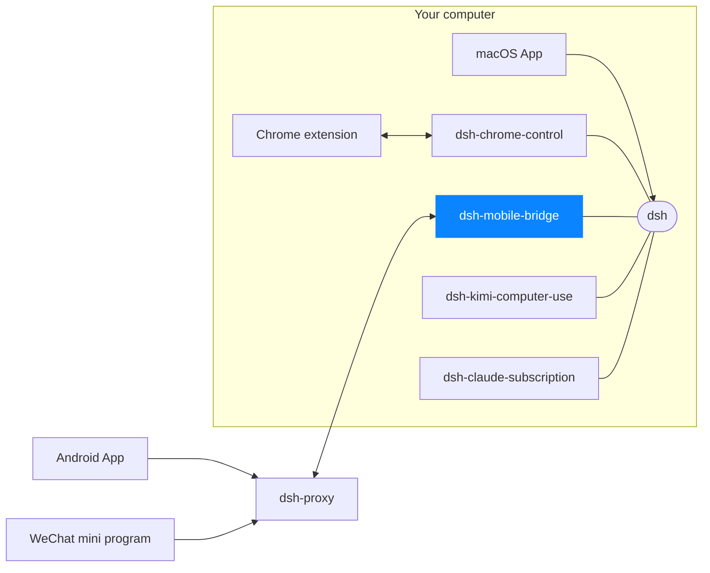

# dsh-mobile-bridge

Serves this harness's `/api` to paired phones, over a Noise-encrypted tunnel to
a public [`dsh-proxy`](https://github.com/dshapp/dsh-proxy). It opens **no port**, writes **no state
file**, runs **no extra process**, and forges **no cookie**: it is a cordis
plugin that lives and dies with `dsh server`.

```
iPhone --bare TCP--> dsh-proxy --mux over Noise_XX--> this plugin --in process--> dsh
        Noise_IK, end to end between the phone and this plugin
```

- **Authentication is the handshake.** Noise_IK proves the device's static key
  (that key *is* the device id) and proves us to the device. A device that is
  neither whitelisted nor carrying a live pairing token is dropped before any
  harness traffic is served, and one that stalls mid-handshake is dropped after
  `handshakeTimeoutMs`. No TLS, no certificate, no bearer token.
- **A phone reaches only what it needs.** The handshake says *who* is calling;
  an allowlist decides *what* they may call. Exact plugin routes are
  default-deny, the RPC channel `/api/<namespace>/<method>` is open, and the
  bridge's own control plane is refused outright.
- **The proxy learns nothing.** It reads a 37-byte routing preamble and copies
  bytes; it cannot decrypt, and it stores nothing on disk. The routing key is
  an identifier, not a secret — it is in the pairing QR code, so neither side
  writes it to a log.

See [PROTOCOL.md](PROTOCOL.md) for the wire format.

## Install

```sh
dsh plugin --profile web add dsh-mobile-bridge
```

## Config

```yaml
- id: mobile-bridge
  config:
    proxyHost: 127.0.0.1   # public proxy the phone dials
    proxyPort: 8787
    proxyPublicKey: ''     # optional base64 key to pin
    deviceTtlDays: 180
    handshakeTimeoutMs: 10000   # preamble + Noise_IK deadline
    apiAllowlist: []       # extra exact /api routes, added to the defaults
```

The default allowlist is `/api/file`, `/api/session/uploadFileBinary`,
`/api/remote.mux`, `/api/changes.summary` and `/api/changes.diff`;
`apiAllowlist` extends it rather than replacing it. The two `changes.*` entries
are readings behind a turn's changed-files card — `GET`, so the RPC rule
(`POST` + JSON) would not admit them.

## Control API

Exact routes on the shared channel, for the Mac app:

| route | answer |
|---|---|
| `POST /api/mobileBridge/status` | `bridgeKey`, proxy address, `connected`, `disabled`, `deviceName`, `now`, the live `pairing` (or `null`), paired `devices` |
| `POST /api/mobileBridge/pair` | a fresh one-shot `dshm://` pairing URL, its expiry and `deviceName` |
| `POST /api/mobileBridge/revoke` | `{ removed }` for one `deviceId` |
| `POST /api/mobileBridge/rename` | `{ renamed }` — sets one device's display `label` |
| `POST /api/mobileBridge/disconnect` | `{ connected: false }` — cuts the relay link until `connect` |
| `POST /api/mobileBridge/connect` | `{ connected }` — reconnects after `disconnect` |

`disconnect` cuts the relay for every phone at once: it tears down the tunnel
and with it every stream a phone was holding, then stops reconnecting until
`connect` is called. `disabled` is the operator's own intent, which `connected`
alone cannot express — that flag also goes false while the link is merely down.

Each device carries `online`: the bridge counts the streams a phone actually
holds, so presence is observed, not guessed from `lastSeenAt` — which is
refreshed the moment the last of those streams goes away.

`rename` rewrites one device's `label` — the name a management screen shows.
Pairing seeds it from the device key, so this is the only way a paired phone
gets a name its owner recognises. It is presentation only: authorization reads
`deviceId`, never the label. A blank label is refused (`renamed: false`), and
a label is capped at 64 characters.

These routes are for management screens, which reach them over the authenticated
localhost web channel. A paired phone is answered `403` on them: `pair` mints
codes and `revoke` ejects devices, so neither belongs on the phone channel.
Revoking a device also hangs up on the connections it already holds, rather
than waiting for it to close them.

`status` answers everything a pairing screen displays and changes nothing:
the live code disappears from it the moment a phone redeems it or it expires,
so a client needs no timer of its own. Turning that URL into a QR code is the
screen's job — the bridge owns what the code says, not how it is drawn.

## Web page

The plugin ships the same screen as a browser page, so mobile access does not
require the Mac app:

```
http://127.0.0.1:3080/mobileaccess
```

It covers the whole control surface — relay state with cut and restore, the
paired phones with presence, rename and revoke, and the pairing code — and it
is the plugin's own asset: one self-contained document (inline style and
script, no CDN, no separate build), talking to the routes above on the same
origin. The pairing code is drawn server-side at `/mobileaccess/qr`; the QR encoder
is bundled, so the bridge still has no runtime dependency of its own.

Both routes sit behind the ordinary browser fence (`requestRejection`), so
opening the harness once with the URL `dsh web` prints is what makes `/mobileaccess`
reachable; a phone cannot reach it at all. The URL is announced on the console
at startup next to `dsh web:`. In a composition with no web server the page
does not exist and the tunnel is unaffected.

## Develop

```sh
pnpm install
pnpm run check      # typecheck + build
dsh plugin --profile web add link:$PWD
```

<!-- dsh-family:start -->
## The DSH App family

**DSH App** is a family of clients and plugins built for [DeepSeek Harness](https://github.com/deepseek-ai/deepseek-harness) (`dsh`). Every piece plugs into the **same** dsh on your computer, so sessions, models and plugins are shared everywhere — combine the ones you need. Downloads and docs: **[dshapp.github.io](https://dshapp.github.io/en/)**.



| | Project | What it does | Links |
| --- | --- | --- | --- |
| Clients | **macOS App**<br>`dsh-macapp` | Native SwiftUI client that hosts your local dsh and switches on every extension | [Overview](https://dshapp.github.io/en/products/macos/) · source coming soon |
|  | **Android App**<br>`dsh-androidapp` | DSH in your pocket: approvals, questions and notifications, end-to-end encrypted | [Overview](https://dshapp.github.io/en/products/android/) · source coming soon |
|  | **DSH Remote (WeChat)**<br>`dsh-miniapp` | No install: take over DSH from WeChat on iPhone or Android | [Overview](https://dshapp.github.io/en/products/miniapp/) · source coming soon |
|  | **Chrome extension**<br>`dsh-chrome-extension` | DSH in the browser side panel, and the executing half of browser control | [Overview](https://dshapp.github.io/en/products/chrome/) · source coming soon |
| dsh plugins | **Browser control**<br>`dsh-chrome-control` | Hands your signed-in Chrome to the agent as `mcp__chrome__*` tools | [Overview](https://dshapp.github.io/en/products/chrome/) · [Source](https://github.com/dshapp/dsh-chrome-control) |
|  | **Mobile bridge** ← you are here<br>`dsh-mobile-bridge` | Serves dsh to paired phones over a Noise tunnel, without opening a port | [Overview](https://dshapp.github.io/en/products/android/) |
|  | **Computer use**<br>`dsh-kimi-computer-use` | Lets the agent operate Mac apps that have no API, in the background | [Overview](https://dshapp.github.io/en/products/cu/) · [Source](https://github.com/dshapp/dsh-kimi-computer-use) |
|  | **Claude subscription**<br>`dsh-claude-subscription` | Runs Claude models in DSH on your Claude Code subscription, no API key | [Source](https://github.com/dshapp/dsh-claude-subscription) |
| Infrastructure | **Relay**<br>`dsh-proxy` | The only public piece of mobile access: one port, ciphertext only, no state | [Overview](https://dshapp.github.io/en/docs/crypto/) · [Source](https://github.com/dshapp/dsh-proxy) |
|  | **Website**<br>`dshapp.github.io` | Downloads, docs and release notes | [Overview](https://dshapp.github.io/en/) · [Source](https://github.com/dshapp/dshapp.github.io) |
<!-- dsh-family:end -->
